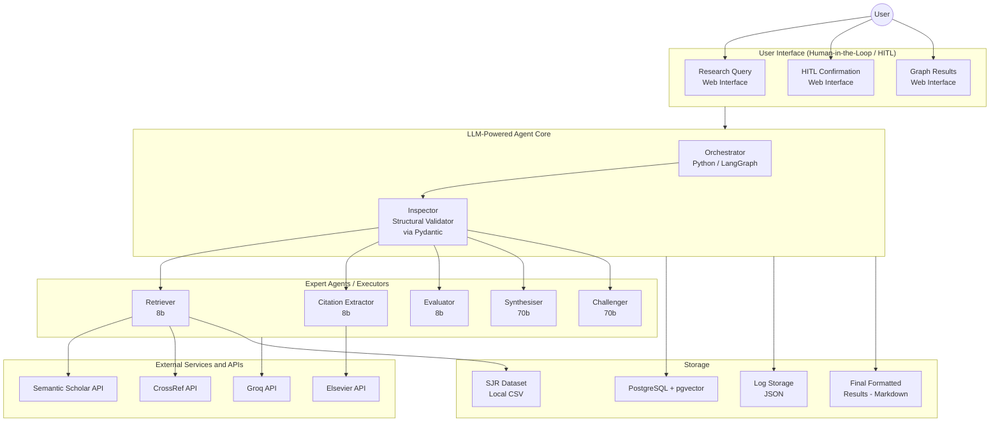
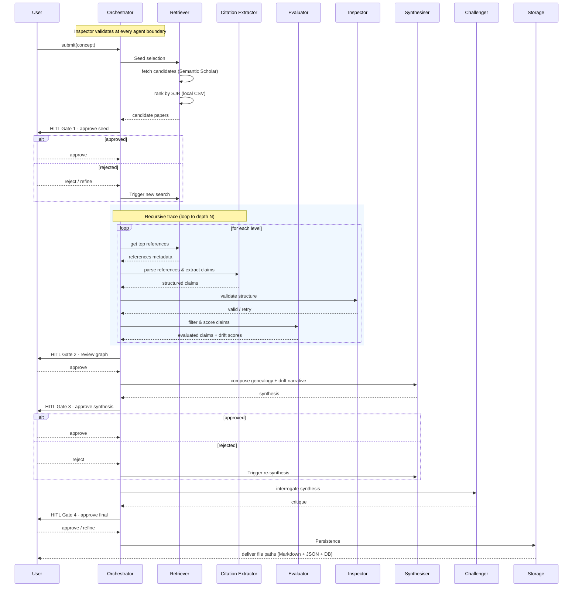
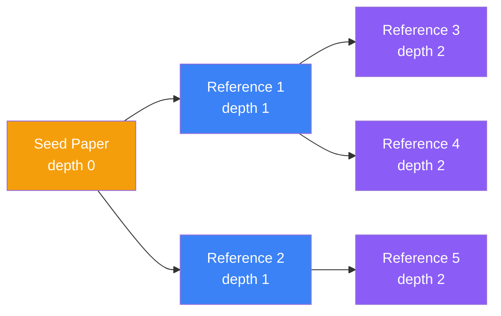

# Concept Genealogy

**Module:** Intelligent Agents  
**University of Essex Online**

An LLM-powered multi-agent system for academic concept tracing and genealogy. The system takes a user-defined concept, identifies a highly cited "Gold Standard" seed paper, and recursively extracts and tracks its underlying claims backward through its citation chains. It builds an inverted semantic provenance graph that maps the genealogical evolution and conceptual drift of the idea across multiple levels of research, ensuring traceable outputs with a human kept in the loop at each key decision point.

---

## Architecture

The system adopts a **hybrid deliberative-stateless architecture** (Stone and Veloso, 2000). A centralised deliberative Orchestrator manages global state and execution loops via LangGraph, decomposing high-level research goals into actionable sub-tasks (Russell and Norvig, 2021), following resource-bounded practical reasoning (Bratman et al., 1988). Execution-level tasks are handled by stateless worker nodes - single-responsibility agents that receive only the slice of state they need, process it, and return typed output without access to global pipeline state. This structural separation isolates failures at the agent boundary level, preventing context-window degradation in the Orchestrator, keeping token expenditure proportional by assigning lightweight models to stateless worker nodes and larger models only where comparative reasoning is required.



### Agent Roles

| Agent | Model | Input | Output |
|-------|-------|-------|--------|
| **Orchestrator** | - | High-level user query | Decomposed sub-tasks and global state management |
| **Retriever** | - | Decomposed sub-tasks | Academic metadata and top-3 candidate seed papers |
| **Citation Extractor** | llama-3.1-8b | Approved seed paper / references | Extracted inline citations, reference chains, and raw claims |
| **Evaluator** | llama-3.1-8b | Extracted raw claims and context | Filtered relevant concepts, claim validity scores, and drift detection |
| **Synthesiser** | llama-3.3-70b | Validated claims and citation data | Grounded synthesis and literature genealogy narrative |
| **Challenger** | llama-3.3-70b | Synthesised summary | Conceptual drift analysis and counter-arguments |
| **Inspector** | - | Raw structured output from any agent | Schema-compliant JSON or rejection signal triggering retry |

### Execution Constraints

- Max 1 retry for Pydantic validation errors (Inspector)
- Max 3 retries for Synthesiser/Challenger debates

### Human-in-the-Loop (HITL) Gates

The pipeline pauses at mandatory decision points requiring user approval (Mosqueira-Rey et al., 2023):

1. **Seed Selection** (concept mode) - User confirms or rejects the top-ranked seed paper
1. **Concept Selection** (DOI mode) - User selects up to 3 concepts to trace from the provided paper
2. **Graph Review** - User reviews the citation tracing tree before synthesis. This gate prevents unnecessary Synthesiser/Challenger invocations (the most expensive 70b model calls) when the graph is incomplete or structurally incorrect
3. **Synthesis Approval** - User accepts or requests revision of the narrative
4. **Final Approval** - User signs off on the complete output (with challenger critique)

### Execution Workflow



---

## Key Design Decisions

| Decision | Rationale |
|----------|-----------|
| **LangGraph over linear DAG** | Pipeline requires cycles: HITL rejections loop back, citation tracing iterates over depth levels (Sapkota et al., 2025) |
| **Centralised orchestration** | Prevents context-window degradation; agents receive only their required state slice (Dang et al., 2025) |
| **Groq inference (not OpenAI)** | Free-tier availability for academic use; LPU architecture ensures low-latency execution vital for agent coordination (Groq, 2025a) under academic-friendly license (Groq, 2025b) |
| **Recursive citation tracing** | Depth-bounded traversal with configurable fan-out (`papers_per_level=3`) at each level; constrained snowball sampling prevents citation-graph explosion (Lecy and Beatty, 2012). At each depth transition, concept abstraction adapts the search concept to ancestral terminology |
| **Three-strategy content fallback** | OA PDF → Elsevier API via DOI → abstract-only. Most journal papers are not available in Open Access; Elsevier institutional API enables full-text extraction for paywalled papers, maximising coverage |
| **CrossRef reference fallback** | Semantic Scholar's reference index has coverage gaps - some highly-cited papers return zero references despite having extensive bibliographies. CrossRef serves as the primary reference source: reference DOIs are fetched from publisher-deposited metadata and batch-resolved back to Semantic Scholar paper IDs. CrossRef has no rate limit, preserving the S2 budget for paper metadata. S2 `/references` is used as fallback when no DOI is available |
| **SJR-ranked reference selection** | When `papers_per_level` limits how many references are traced at each depth, the system fetches metadata for all candidate references and ranks them by SCImago Journal Rank before selecting the top-N, ensuring the highest-quality citation chains are followed first |
| **Depth-adaptive concept abstraction** | Modern terminology often did not exist in older papers. At each depth transition, the LLM identifies the precursor concept from extracted claims (e.g., "attention mechanism" → "selective attention" → "feature-based saliency"). The Evaluator uses this abstracted term for relevance matching, preventing valid ancestral papers from being discarded due to terminology mismatch |
| **Local SJR CSV** | Avoids runtime HTTP dependency for journal ranking; SCImago dataset bundled in `data/` (SCImago, n.d.) |
| **PostgreSQL + pgvector** | Single database unifying metadata and embeddings, avoiding dedicated vector database overhead (pgvector, 2021) |
| **Explicit Evaluator gate** | Isolates relevant claims before synthesis, reducing hallucination propagation across pipeline stages (Maynez et al., 2020) |
| **Inspector at every boundary** | Deterministic Pydantic validation handles persistent LLM non-determinism (Atıl et al., 2025; Cemri et al., 2025) |
| **Challenger adversarial review** | Structured adversarial debate to surface weak claims and enforce robust conclusions (Irving, Christiano and Amodei, 2018) |

---

## Deviations from Design Proposal

The following enhancements were made during implementation beyond the original design proposal (Group B Project Report):

| Area | Proposal | Implementation | Rationale |
|------|----------|----------------|-----------|
| **HITL Gates** | 3 gates (seed, synthesis, final) | 4 gates (added Graph Review before synthesis) | The Synthesiser (70b) and Challenger (70b) are the most expensive pipeline stages. Presenting the citation graph for user review before invoking these models prevents wasted LLM calls on an incomplete or structurally incorrect tracing tree - the user can reject early at near-zero cost |
| **Content fallback** | Semantic Scholar resolves OA PDFs natively (AI2, 2023; arXiv, n.d.) | OA PDF → Elsevier API → abstract-only fallback chain | The majority of journal papers are not available in Open Access. Since institutional Elsevier API access permits full-text data mining by DOI, adding this fallback significantly increases the proportion of papers from which claims can be extracted at full confidence |
| **Reference retrieval** | Semantic Scholar `/references` endpoint only | CrossRef API primary → S2 `/references` fallback | Semantic Scholar has indexing gaps where peer-reviewed papers with extensive bibliographies return zero references. CrossRef receives publisher-deposited reference metadata directly from Elsevier, Springer, and Wiley, providing near-complete coverage. CrossRef is queried first (no rate limit), preserving the S2 rate budget for paper metadata fetches. DOIs are batch-resolved to S2 paper IDs via the `/paper/batch` endpoint |
| **Reference selection** | Arbitrary ordering (first N references) | SJR-ranked selection at each depth level | When `papers_per_level` limits how many references are traced, selecting the first N arbitrarily may follow low-quality citation chains. The system now fetches metadata for candidate references and ranks them by SJR before selecting the top-N, ensuring the highest-quality journals are traced preferentially (SCImago, n.d.) |
| **Concept abstraction** | Static concept matching across all depths | Depth-adaptive concept abstraction via LLM | As citation tracing moves backward in time, modern terminology often did not exist in older papers (e.g., "attention mechanism" → "selective attention" → "feature-based saliency"). Without adapting the search concept, the relevance filter discards ancestral papers using older terminology. At each depth transition, the LLM identifies the precursor concept from extracted claims, and the Evaluator uses this abstracted term for relevance matching at the next depth |
| **Graph visualisation** | Not specified in proposal | Interactive graph with node labels (title/author/DOI), edge labels (traced concept), path highlighting on node click, and breadcrumb concept trail | The genealogy graph is the primary analytical output of the system. Rich metadata labels (title, first author, year, DOI link) eliminate the need to cross-reference external databases. Concept-labelled edges make the concept evolution visible at a glance. Path highlighting with breadcrumbs enables the user to trace any paper's lineage back to the seed, supporting the Graph Review HITL gate's decision-making |
| **DOI input mode** | Concept-only input (user provides a concept string) | Dual-mode input: concept string OR direct DOI. When a DOI is provided, the paper becomes the Gold Standard seed directly, and the LLM extracts key concepts for the user to select up to 3 to trace | Researchers often start from a specific paper they know well, not a concept keyword. DOI mode skips the seed search and eliminates the seed selection HITL gate (the paper IS the seed). Since a paper typically contributes to many concepts, presenting extracted concepts for selection (max 3) bounds the tracing scope and prevents resource waste from tracking every concept in the paper |
| **Output format** | "Final Formatted results (json)" | JSON + Markdown dual output per run | JSON preserves machine-readable structure for future retrieval and embedding; Markdown provides a human-readable report that can be immediately shared, read in any editor, or rendered in the frontend's result detail view |
| **Frontend** | "Web Interface" (unspecified framework) | Full SPA: Vue 3 + Vite with live pipeline monitoring, progress bar with stage indicators, real-time log streaming, interactive HITL gates, run history browser, and result detail view | The DPD specified a web interface but left implementation open. A reactive SPA with real-time WebSocket-style polling provides immediate pipeline visibility, eliminating the need for page refreshes during long-running traces and enabling seamless HITL gate interaction |
| **Challenger** | Multi-turn adversarial debate between Synthesiser and Challenger with max 3 debate retries (§5, §6) | Single-sided multi-round adversarial review (MAX_DEBATE_ROUNDS=2). Challenger generates structured JSON critique (issues with type/severity/quote/explanation, overall assessment, recommendation) against the static synthesis using traced evidence. Graceful fallback to coverage-only review without LLM | The DPD specified a bidirectional debate where the Synthesiser would respond to challenges and revise in-place. The implementation uses a single-sided approach: the Challenger critiques, and the **user** decides (at HITL Gate 3) whether to accept or send the synthesis back for revision. This preserves human agency over the revision decision rather than delegating it to an automated Synthesiser response loop |
| **Drift analysis trigger** | Explicit user choice: "User wants to analyse conceptual drift?" diamond after synthesis approval (§6 activity diagram) | Challenger always runs automatically after synthesis approval - no user opt-in/opt-out gate | The Challenger's adversarial review is lightweight relative to the full tracing pipeline. Making it automatic ensures every synthesis is quality-checked without requiring the user to understand when drift analysis is warranted. The cost (one LLM call) is negligible compared to the tracing phase |

### Pending Features from Design Proposal

The following features specified in the DPD activity diagram (§6) are not yet implemented:

| Feature | DPD Specification | Current State | Notes |
|---------|-------------------|---------------|-------|
| **Synthesiser↔Challenger debate** | Bidirectional multi-turn: Challenger critiques → Synthesiser revises synthesis → Challenger re-evaluates (up to 3 rounds) | Single-sided: Challenger critiques static synthesis; revision only occurs if user rejects at HITL Gate 3 and the pipeline loops back to the Synthesise node | Implementing a bidirectional debate requires either a LangGraph subgraph (nested conversation state) or an inner loop between the synthesise and challenge nodes |
| **Synthesis retry cap with halt** | "Challenger review > 3" → "Log failure state & halt pipeline" (explicit halt path in diagram) | Implemented: `_route_after_synthesis_review` and `_route_after_final_review` check `synthesiser_retries >= max_synthesiser_retries` and route to persist with `synthesis_status="partial_consensus"` | Debate terminates gracefully with partial output rather than erroring out via `max_iterations` |
| **User opt-out of drift analysis** | Diamond gate: "User does NOT want to analyse conceptual drift" → terminate directly without running Challenger | Challenger always runs after synthesis approval. User cannot skip it | Could be implemented as a conditional edge after HITL Gate 2: approved → ask user → challenge or persist directly |
| **Explicit paper discard logging** | "Discard paper" and "Discard reference" nodes with dedicated loop-back paths when score < threshold or no valid concepts remain | Implicit: low-scoring claims are excluded from TracingResult; papers with no valid claims produce empty results that are still appended to state | The current approach is functionally equivalent but lacks the explicit audit trail of which papers/references were discarded and why |
| **"No valid Gold Standard" notification** | Dedicated decision path: "no valid gold standard" → "Notify user: No valid Gold Standard found" node | Retriever returns an empty candidate list; user sees 0 candidates at HITL Gate 1 without a specific explanatory message | Requires a conditional check after retrieval with a dedicated error message before presenting HITL Gate 1 |

---

## Getting Started

### Prerequisites

- Python 3.12+
- Node.js 18+
- Docker & Docker Compose (for PostgreSQL)
- Groq API key ([console.groq.com](https://console.groq.com))

### 1. Clone and configure

```bash
git clone <repo-url>
cd concept-genealogy
cp backend/.env.example backend/.env
# Edit backend/.env with your API keys
```

Required environment variables:

| Variable | Description |
|----------|-------------|
| `GROQ_API_KEY` | Groq API key (required) |
| `SEMANTIC_SCHOLAR_API_KEY` | Semantic Scholar API key (optional, raises rate limits) |
| `ELSEVIER_API_KEY` | Elsevier API key (optional, enables non-OA full-text retrieval) |
| `MAX_DEPTH` | Citation tracing depth (default: 3) |
| `MAX_CANDIDATES` | Seed paper candidates presented to user (default: 3) |

### 2. Start the database

```bash
docker compose up db -d
```

### 3. Run the backend

```bash
cd backend
pip install -r requirements.txt
uvicorn api:app --reload --port 8000
```

### 4. Run the frontend

```bash
cd frontend
npm install
npm run dev
```

The UI is available at `http://localhost:5173`.

### Full Docker deployment

```bash
docker compose up --build
```

This starts all three services (PostgreSQL, backend on `:8000`, frontend on `:80`).

---

## API Endpoints

| Method | Path | Description |
|--------|------|-------------|
| `POST` | `/api/runs` | Start a new genealogy tracing run |
| `GET` | `/api/runs` | List all runs |
| `GET` | `/api/runs/{run_id}` | Get run status and current HITL gate info |
| `POST` | `/api/runs/{run_id}/gate` | Respond to the current HITL gate |
| `GET` | `/api/runs/{run_id}/logs` | Get pipeline log messages |
| `GET` | `/api/runs/{run_id}/result` | Get final result (JSON) |
| `GET` | `/api/runs/{run_id}/graph` | Get genealogy graph (nodes + edges) |

---

## Project Structure

```
concept-genealogy/
├── backend/
│   ├── api.py                    # FastAPI endpoints + HITL web gate
│   ├── core/
│   │   ├── config.py             # Pydantic BaseSettings configuration
│   │   ├── orchestrator.py       # LangGraph StateGraph (deliberative layer)
│   │   └── state.py              # Global pipeline state schema
│   ├── agents/
│   │   ├── retriever.py          # Semantic Scholar search + SJR ranking
│   │   ├── citation_extractor.py # PDF/Elsevier/abstract claim extraction
│   │   ├── evaluator.py          # Relevance filtering + validity scoring
│   │   ├── inspector.py          # Schema validation + retry logic
│   │   ├── synthesiser.py        # Grounded narrative generation
│   │   ├── challenger.py         # Critical review of synthesis
│   │   ├── elsevier_client.py    # Elsevier ScienceDirect API client
│   │   └── hitl.py               # Human-in-the-loop gate interface
│   ├── storage/
│   │   └── persistence.py        # PostgreSQL + JSON + Markdown output
│   ├── data/
│   │   └── scimagojr2025.csv     # SCImago Journal Rankings dataset
│   └── output/                   # Generated run results
├── frontend/
│   └── src/
│       ├── views/                # HomeView, RunView, HistoryView, ResultView
│       ├── components/           # GenealogyGraph (v-network-graph + dagre)
│       └── api.js                # Backend API client
├── docker-compose.yml            # PostgreSQL + backend + frontend
├── Dockerfile                    # Backend container (Python 3.12-slim)
└── docs/
    └── implementation-plan.md    # Weekly sprint plan
```

---

## Graph Visualisation

The genealogy graph builds an inverted semantic provenance graph following the actual citation chain. Edge direction represents "cites" - the seed paper cites its references, which in turn cite their own references:



Nodes are colour-coded by depth (amber → blue → purple → green → red → indigo) and laid out using dagre's hierarchical algorithm. The seed node is visually larger. The graph is displayed at the Graph Review HITL gate for user review before synthesis begins.

### Node Labels

Each node displays rich metadata to eliminate the need for cross-referencing:
- **Title** - paper title (bold, primary label)
- **First author + year** - authorship and temporal context
- **DOI link** - clickable external reference

### Edge Labels

Edges between papers display the **concept being traced** at that depth level. This makes concept evolution visible directly on the graph (e.g., edges at depth 0 show "attention mechanism", depth 1 edges show "selective attention").

### Path Highlighting

Clicking any node highlights the full path from that node back to the seed paper. This uses depth-aware edge filtering to prevent cycles from same-depth cross-references. The highlighted path is displayed in the colour of the seed node.

### Breadcrumbs

Below the graph, a **breadcrumb trail** shows the concept evolution along the highlighted path - each paper's title in the chain from seed to the selected node, with arrows indicating the direction of the citation chain.

---

## DOI Input Mode

In addition to concept-based input, the system supports **direct DOI input**:

1. User provides a DOI instead of a concept keyword
2. System validates the DOI via CrossRef and fetches metadata from Semantic Scholar
3. The paper becomes the Gold Standard seed directly (no seed search required)
4. The system extracts key academic concepts from the paper text (via LLM)
5. User selects up to 3 concepts to trace (Concept Selection HITL gate)
6. The selected primary concept drives the citation tracing, same as concept mode

This mode is designed for researchers who start from a specific paper they know well and want to trace specific ideas from it backward through the literature.

---

## Technology Stack & Acknowledgments

All external libraries, frameworks, and models used in this project are acknowledged below with their purpose and license.

### Backend (Python 3.12)

| Library | Version | Purpose | License |
|---------|---------|---------|---------|
| **FastAPI** | ≥0.115 | Async REST API framework for HITL gate endpoints and pipeline control | MIT |
| **Uvicorn** | ≥0.30 | ASGI server for FastAPI | BSD-3-Clause |
| **LangGraph** | ≥0.2 | StateGraph execution engine enabling cyclic workflows for HITL loops and recursive citation tracing (Sapkota et al., 2025) | MIT |
| **LangChain-Core** | ≥0.3 | Foundation dependency for LangGraph's state management primitives | MIT |
| **Groq** | ≥0.9 | Python client for Groq LPU inference API (Groq, 2025a) - hosts Llama 3.1/3.3 models | Apache-2.0 |
| **PyMuPDF (fitz)** | ≥1.24 | PDF text extraction with high fidelity for multi-column academic layouts (Artifex Software, 2026) | AGPL-3.0 |
| **httpx** | ≥0.27 | HTTP client for Semantic Scholar, CrossRef, and Elsevier API calls (sync mode for LangGraph compatibility) | BSD-3-Clause |
| **Pydantic** | ≥2.7 | Data validation and schema enforcement at agent boundaries (Atıl et al., 2025) | MIT |
| **Pydantic-Settings** | ≥2.3 | Environment variable loading and validation | MIT |
| **psycopg2-binary** | ≥2.9 | PostgreSQL adapter for claims persistence and pgvector operations | LGPL-3.0 |
| **sentence-transformers** | ≥3.0 | Embedding model (`all-mpnet-base-v2`, 768d) for semantic drift detection (Reimers and Gurevych, 2019) | Apache-2.0 |
| **pytest** | ≥8.0 | Test framework for unit and integration tests | MIT |
| **pytest-cov** | ≥5.0 | Coverage measurement integrated with pytest | MIT |

### Frontend (Node.js 18+)

| Library | Version | Purpose | License |
|---------|---------|---------|---------|
| **Vue 3** | ≥3.5 | Reactive SPA framework for HITL gate UI and pipeline monitoring | MIT |
| **Vue Router** | ≥4.5 | Client-side routing (HomeView, RunView, HistoryView, ResultView) | MIT |
| **Vite** | ≥6.3 | Build tool and development server with HMR | MIT |
| **v-network-graph** | ≥0.9 | Interactive graph visualisation component for the genealogy DAG | MIT |
| **dagre** | ^0.8.5 | Hierarchical graph layout algorithm for depth-based node positioning | MIT |

### Infrastructure

| Technology | Purpose | License |
|------------|---------|---------|
| **PostgreSQL 16** | Relational storage for claims, run metadata, and pgvector embeddings | PostgreSQL License |
| **pgvector** | Vector similarity search extension for PostgreSQL (pgvector, 2021) | PostgreSQL License |
| **Docker / Docker Compose** | Containerised deployment of database, backend, and frontend | Apache-2.0 |

### LLM Models (via Groq API)

| Model | Parameters | Usage | Provider |
|-------|-----------|-------|----------|
| **Llama 3.1 8B Instant** | 8B | Citation Extractor, Evaluator, concept abstraction (fast, classification tasks) | Meta (Llama 3.1 Community License) via Groq |
| **Llama 3.3 70B Versatile** | 70B | Synthesiser, Challenger (comparative reasoning requiring larger context) | Meta (Llama 3.3 Community License) via Groq |

### External APIs

| API | Purpose | Authentication |
|-----|---------|---------------|
| **Semantic Scholar API** | Paper search, metadata retrieval, reference resolution (AI2, 2023) | Optional API key (raises rate limits) |
| **CrossRef API** | Reference DOI retrieval from publisher-deposited metadata; DOI validation | No authentication required |
| **Elsevier Article Retrieval API** | Full-text extraction for non-OA papers via institutional DOI-based access | Elsevier API key (institutional) |

### Data Assets

| Asset | Source | Purpose |
|-------|--------|---------|
| **scimagojr2025.csv** | SCImago Journal & Country Rank (n.d.) | Local SJR journal ranking for deterministic reference prioritisation |

---

## Testing

Test suite output and coverage reports are saved in `backend/test-output/` for submission. To regenerate:

```bash
cd backend
.venv\Scripts\python.exe -m pytest tests/ -v --tb=short > test-output/test-results.txt 2>&1
.venv\Scripts\python.exe -m pytest tests/ --cov=. --cov-report=term-missing > test-output/coverage-report.txt 2>&1
```

---

## Feedback Remediation

The following changes were applied in response to examiner feedback on the initial submission:

| # | Feedback Item | Change Implemented | Files Modified |
|---|--------------|-------------------|----------------|
| 1 | "Reactive agents" / "subsumption architecture" mislabels centralised LangGraph state management | Renamed to **stateless worker nodes** - agents are genuinely stateless (receive input slice, return typed output) but are not subsumption-style because they don't compete for activation; the Orchestrator explicitly routes | `orchestrator.py`, `state.py`, `config.py`, `evaluator.py`, `citation_extractor.py`, `synthesiser.py`, `retriever.py` |
| 2 | Conceptual drift defined only as a cosine number without qualitative explanation | Added **DRIFT_ANALYSIS_PROMPT** producing three-part qualitative analysis (historical_use, current_use, evolutionary_path) always compared to the gold-standard seed paper definition. Challenger prompts updated with drift definition | `evaluator.py`, `challenger.py`, `state.py` |
| 3 | Debate retry cap defined (`max_synthesiser_retries=3`) but never enforced in routing | Replaced anonymous Gate 2/3 lambdas with named methods (`_route_after_synthesis_review`, `_route_after_final_review`) that check the retry counter and route to persist with `synthesis_status="partial_consensus"` when cap is reached | `orchestrator.py`, `state.py`, `persistence.py` |
| 4 | "Graceful degradation" claimed without evidence of explicit error communication | PDF extraction errors now log paper title and specific failure reason (HTTP status, parse error). Abstract fallback logs configurable confidence value. `abstract_confidence` is configurable via `ABSTRACT_CONFIDENCE` env var (default 0.5) with engineering justification | `citation_extractor.py`, `config.py` |
| 5 | Pipeline iteration limits (3 retries, 2 debate rounds, 1 inspector retry) presented as arbitrary design choices | Comments replaced with engineering justifications grounded in Groq free-tier rate limits (30 req/min for 70b), diminishing LLM output variance beyond 3 iterations (Atıl et al., 2025), and request budget proportionality | `state.py`, `challenger.py` |

---

## References

- AI2 (2023) Semantic Scholar API License Agreement. Available at: https://www.semanticscholar.org/product/api/license.
- Artifex Software, Inc. (2026) PyMuPDF. Available at: https://github.com/pymupdf/PyMuPDF.
- Atıl, B., et al. (2025) Non-determinism of "deterministic" LLM system settings in hosted environments. *Proceedings of the 5th Workshop on Evaluation and Comparison of NLP Systems*, pp. 135-148. doi:10.18653/v1/2025.eval4nlp-1.12.
- Bratman, M.E., Israel, D.J. & Pollack, M.E. (1988) Plans and resource-bounded practical reasoning. *Computational Intelligence*, 4(4), 349-355.
- Brooks, R.A. (1991) Intelligence without representation. *Artificial Intelligence*, 47(1-3), 139-159.
- Cemri, M., et al. (2025) Why do multi-agent LLM systems fail? *NeurIPS 2025 Datasets and Benchmarks Track*.
- Dang, Y. et al. (2025) Multi-Agent Collaboration via Evolving Orchestration. arXiv:2505.19591.
- Groq (2025a) Rate limits. Available at: https://console.groq.com/docs/rate-limits.
- Groq (2025b) Acceptable use and responsible AI policy. Available at: https://console.groq.com/docs/legal/ai-policy.
- Irving, G., Christiano, P. & Amodei, D. (2018) AI safety via debate. arXiv:1805.00899.
- Lecy, J.D. & Beatty, K.E. (2012) Representative literature reviews using constrained snowball sampling and citation network analysis. *SSRN Electronic Journal*. doi:10.2139/ssrn.1992601.
- Maynez, J. et al. (2020) On faithfulness and factuality in abstractive summarization. *ACL 2020*, 1906-1919.
- Mosqueira-Rey, E. et al. (2023) Human-in-the-loop machine learning: a state of the art. *Artificial Intelligence Review*, 56(4), 3005-3054.
- pgvector (2021) pgvector: open-source vector similarity search for PostgreSQL. Available at: https://github.com/pgvector/pgvector.
- Reimers, N. & Gurevych, I. (2019) Sentence-BERT. *EMNLP 2019*, 3982-3992.
- Russell, S. & Norvig, P. (2021) *Artificial Intelligence: A Modern Approach*. 4th edn. Pearson.
- Sapkota, R. et al. (2025) LangChain vs. LangGraph vs. LangSmith. *TechRxiv*. doi:10.36227/techrxiv.175695645.52670060/v1.
- SCImago Journal & Country Rank (n.d.) Available at: https://www.scimagojr.com/journalrank.php.
- Stone, P. & Veloso, M. (2000) Multiagent systems: a survey. *Autonomous Robots*, 8(3), 345-383.
