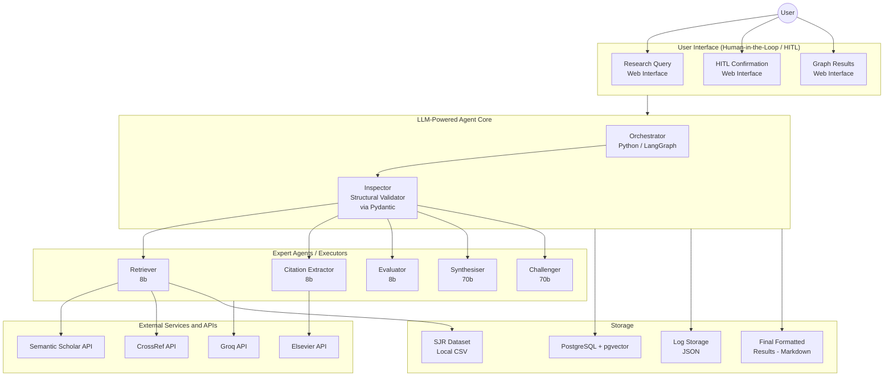

# Concept Genealogy

**Module:** Intelligent Agents
**University of Essex Online**

An LLM-powered multi-agent system for academic concept tracing and genealogy. The system takes a user-defined concept, identifies a highly cited "Gold Standard" seed paper, and recursively extracts and tracks its underlying claims backward through its citation chains. It builds an inverted semantic provenance graph that maps the genealogical evolution and conceptual drift of the idea across multiple levels of research, ensuring traceable outputs with a human kept in the loop at each key decision point.

---

## Purpose

This is the practical development deliverable for the *Intelligent Agents* module, building on the design proposal submitted in Unit 6. It implements an LLM-powered planning agent: given a single goal (a research concept, or a paper DOI), the system plans a sequence of retrieval and processing actions, retrieves and processes academic literature data, and produces a meaningful output - a citation-grounded genealogy narrative with conceptual drift analysis.

It is realised as a **cooperating multi-agent system**, with agents taking on distinct responsibilities for planning, retrieval, extraction, evaluation, validation, synthesis and critique (see below).

---

## Overview

A centralised **Orchestrator** (built with LangGraph) decomposes the user's goal into sub-tasks and delegates each to a stateless specialist agent. Every agent's output is structurally validated against a Pydantic schema (the **Inspector**) before being passed downstream, and the pipeline pauses at four human-in-the-loop checkpoints - seed approval, graph review, synthesis approval, and final approval - so the user retains control at each key decision point. The system accepts either a concept keyword or a paper DOI as input.



### Agent Roles

| Agent | Model | Input | Output |
|-------|-------|-------|--------|
| **Orchestrator** | - | High-level user query | Decomposed sub-tasks and global state management |
| **Retriever** | - | Decomposed sub-tasks | Academic metadata and top-3 candidate seed papers |
| **Citation Extractor** | llama-3.1-8b | Approved seed paper / references | Extracted inline citations, reference chains, and raw claims |
| **Evaluator** | llama-3.1-8b | Extracted raw claims and context | Filtered relevant concepts, claim validity scores, and drift detection |
| **Synthesiser** | llama-3.3-70b | Validated claims and citation data | Grounded synthesis and literature genealogy narrative |
| **Challenger** | llama-3.3-70b | Synthesised summary | Conceptual drift analysis and counter-arguments |
| **Inspector** | - | Raw structured output from any agent | Schema-compliant JSON or rejection signal triggering retry |

Rationale for individual design and implementation decisions (e.g. why LangGraph over a linear DAG, why a four-strategy content-retrieval fallback, why an explicit Evaluator gate) is documented as critical commentary within the code itself, alongside the academic sources that justify each choice.

---

## Technology Stack & Acknowledgments

All external libraries, frameworks, and models used in this project are acknowledged below with their purpose and licence.

### Backend (Python 3.12)

| Library | Version | Purpose | Licence |
|---------|---------|---------|---------|
| **FastAPI** | ≥0.115 | Async REST API framework for HITL gate endpoints and pipeline control | MIT |
| **Uvicorn** | ≥0.30 | ASGI server for FastAPI | BSD-3-Clause |
| **LangGraph** | ≥0.2 | StateGraph execution engine enabling cyclic workflows for HITL loops and recursive citation tracing (Sapkota et al., 2025) | MIT |
| **LangChain-Core** | ≥0.3 | Foundation dependency for LangGraph's state management primitives | MIT |
| **Groq** | ≥0.9 | Python client for Groq LPU inference API (Groq, 2025) - hosts Llama 3.1/3.3 models | Apache-2.0 |
| **PyMuPDF (fitz)** | ≥1.24 | PDF text extraction with high fidelity for multi-column academic layouts (Artifex Software, 2026) | AGPL-3.0 |
| **httpx** | ≥0.27 | HTTP client for Semantic Scholar, CrossRef, and Elsevier API calls (sync mode for LangGraph compatibility) | BSD-3-Clause |
| **Pydantic** | ≥2.7 | Data validation and schema enforcement at agent boundaries (Atıl et al., 2025) | MIT |
| **Pydantic-Settings** | ≥2.3 | Environment variable loading and validation | MIT |
| **psycopg2-binary** | ≥2.9 | PostgreSQL adapter for claims persistence and pgvector operations | LGPL-3.0 |
| **sentence-transformers** | ≥3.0 | Embedding model (`all-mpnet-base-v2`, 768d) for semantic drift detection (Reimers and Gurevych, 2019) | Apache-2.0 |
| **pytest** | ≥8.0 | Test framework for unit and integration tests | MIT |
| **pytest-cov** | ≥5.0 | Coverage measurement integrated with pytest | MIT |

### Frontend (Node.js 18+)

| Library | Version | Purpose | Licence |
|---------|---------|---------|---------|
| **Vue 3** | ≥3.5 | Reactive SPA framework for HITL gate UI and pipeline monitoring | MIT |
| **Vue Router** | ≥4.5 | Client-side routing (HomeView, RunView, HistoryView, ResultView) | MIT |
| **Vite** | ≥6.3 | Build tool and development server with HMR | MIT |
| **v-network-graph** | ≥0.9 | Interactive graph visualisation component for the genealogy DAG | MIT |
| **dagre** | ^0.8.5 | Hierarchical graph layout algorithm for depth-based node positioning | MIT |

### Infrastructure

| Technology | Purpose | Licence |
|------------|---------|---------|
| **PostgreSQL 16** | Relational storage for claims, run metadata, and pgvector embeddings | PostgreSQL License |
| **pgvector** | Vector similarity search extension for PostgreSQL (pgvector, 2021) | PostgreSQL License |
| **Docker / Docker Compose** | Containerised deployment of database, backend, and frontend | Apache-2.0 |

### LLM Models (via Groq API)

| Model | Parameters | Usage | Provider |
|-------|-----------|-------|----------|
| **Llama 3.1 8B Instant** | 8B | Citation Extractor, Evaluator, concept abstraction (fast, classification tasks) | Meta (Llama 3.1 Community License) via Groq |
| **Llama 3.3 70B Versatile** | 70B | Synthesiser, Challenger (comparative reasoning requiring larger context) | Meta (Llama 3.3 Community License) via Groq |

### External APIs

| API | Purpose | Authentication |
|-----|---------|---------------|
| **Semantic Scholar API** | Paper search, metadata retrieval, reference resolution (AI2, 2023) | Optional API key (raises rate limits) |
| **CrossRef API** | Reference DOI retrieval from publisher-deposited metadata; DOI validation | No authentication required |
| **Elsevier Article Retrieval API** | Full-text extraction for non-OA papers via institutional DOI-based access | Elsevier API key (institutional) |

### Data Assets

| Asset | Source | Purpose |
|-------|--------|---------|
| **scimagojr2025.csv** | SCImago Journal & Country Rank (n.d.) | Local SJR journal ranking for deterministic reference prioritisation |

---

## Getting Started

### Prerequisites

- Python 3.12
- Node.js 18+
- Docker & Docker Compose (for PostgreSQL)
- Groq API key ([console.groq.com](https://console.groq.com))
- just command runner (Windows: winget install --id Casey.Just --exact)

### 1. Clone and configure

```bash
git clone <repo-url>
cd concept-genealogy
cp backend/.env.example backend/.env
# Edit backend/.env with your API keys
```

Required environment variables:

| Variable | Description |
|----------|-------------|
| `GROQ_API_KEY` | Groq API key (required) |
| `SEMANTIC_SCHOLAR_API_KEY` | Semantic Scholar API key (optional, raises rate limits) |
| `ELSEVIER_API_KEY` | Elsevier API key (optional, enables non-OA full-text retrieval) |
| `MAX_DEPTH` | Citation tracing depth (default: 3) |
| `MAX_CANDIDATES` | Seed paper candidates presented to user (default: 3) |

### 2. Start the database

```bash
docker compose up db -d
```

### 3. Run the backend

```bash
cd backend
pip install -r requirements.txt
uvicorn api:app --reload --port 8000
```

### 4. Run the frontend

```bash
cd frontend
npm install
npm run dev
```

The UI is available at `http://localhost:5173`.

### Full Docker deployment

```bash
docker compose up --build
```

This starts all three services (PostgreSQL, backend on `:8000`, frontend on `:80`).

### Running tests

```bash
cd backend
pytest tests/ -v --tb=short
pytest tests/ --cov=. --cov-report=term-missing
```

Test output and coverage reports for submission are saved under `backend/test-output/`.

---

## References

- AI2 (2023) Semantic Scholar API License Agreement. Available at: https://www.semanticscholar.org/product/api/license (Accessed: 27 June 2026).
- Artifex Software, Inc. (2026) PyMuPDF. Available at: https://github.com/pymupdf/PyMuPDF (Accessed: 27 June 2026).
- Atıl, B., et al. (2025) Non-determinism of "deterministic" LLM system settings in hosted environments. *Proceedings of the 5th Workshop on Evaluation and Comparison of NLP Systems*, pp. 135-148. doi:10.18653/v1/2025.eval4nlp-1.12.
- Groq (2025) Rate limits. Available at: https://console.groq.com/docs/rate-limits (Accessed: 27 June 2026).
- pgvector (2021) pgvector: open-source vector similarity search for PostgreSQL. Available at: https://github.com/pgvector/pgvector (Accessed: 27 June 2026).
- Reimers, N. & Gurevych, I. (2019) Sentence-BERT. *EMNLP 2019*, 3982-3992.
- Sapkota, R. et al. (2025) LangChain vs. LangGraph vs. LangSmith. *TechRxiv*. doi:10.36227/techrxiv.175695645.52670060/v1.
- SCImago Journal & Country Rank (n.d.) Available at: https://www.scimagojr.com/journalrank.php (Accessed: 27 June 2026).